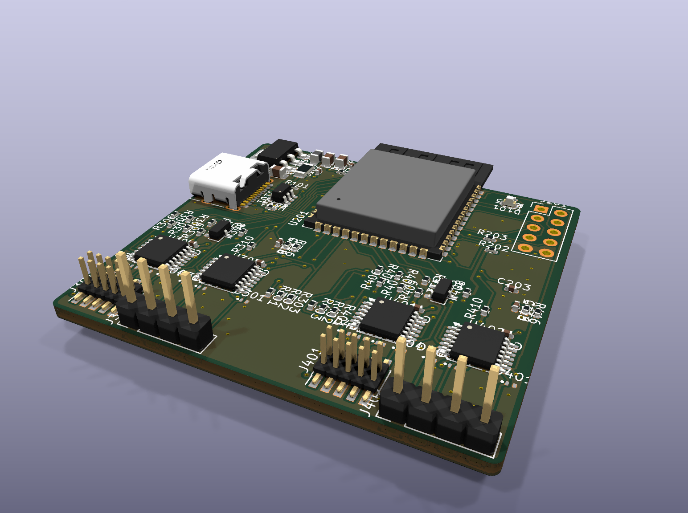

# esp-swd

**esp-swd** is an ESP32-S3 based dual-target SWD flasher and UART bridge with DUT isolation: open hardware, firmware,
a portable C library and a Python host library. It is built for CI and production benches, where a probe stays
plugged in for weeks and flashes the same known 3.3 V targets over and over.

The r5 board sits between a host PC (USB-C) and a device under test (DUT) that carries two MCUs, one per channel.
It does three things:
- programs each MCU over its own SWD port;
- bridges each DUT UART to the host;
- on command, opens analog switches on every DUT line, so the DUT's sleep current can be measured without leakage
  through the tool.



## Status (2026-11-11): MVP
Firmware 0.5.0 (protocol 5) with the `esw` host tools covers the first usable scope:
- **Two SWD channels**, two DUTs flashed at once: `esw flash A=app.hex B=fw.hex`.
- **Two DUT UARTs as terminal devices**, up to 1 Mbaud each, full duplex: the daemon `esw serve` serves them as
  `ttyA`/`ttyB` for picocom, minicom, screen, pyserial and the like.
- **Isolation control:**
  - semi-automatic: the switches close only while used and only with the DUT powered;
  - direct: switch modes `auto`/`on`/`off` per group, from the CLI or Python.
- **Firmware update over USB:** `esw update`, esptool through the chip's USB-Serial-JTAG. No buttons, and it
  recovers even a hung firmware.

Usage: **`host/python/README.md`**. State, open items and next steps: **`docs/status.md`**. Hardware tests:
**`docs/testing.md`**. Everything below is tested on hardware.

Earlier results (board r5, channel A, nRF52840 DK):
- **Isolation interlock:** VTref is checked before any signal switch closes. The switches reopen on VTref loss, host
  loss, reboot and firmware panic.
- **SWD engines:** an ESP32-S3 dedicated-GPIO engine up to 8 MHz (10 MHz cap), and a portable bit-bang fallback.
  Soak: about 3 M packets each at 8 MHz and 10 MHz, 0 errors.
- **Flashing:** 1 MB of random data on an nRF52840 takes **3.42 s** in total: mass erase 0.17 s, program 3.08 s,
  on-target CRC-32 verify 0.17 s. The data path is PC → USB → ESP32-S3 → SWD → NVMC.
- **UART bridge (channel A):** byte-exact at 115200, 460800 and 1 Mbaud, full duplex.
  - A 1 MB stream arrived intact while SWD reads ran in parallel and the host stopped reading for 250 ms.
  - With the switches open nothing gets through, and writes are refused.
- **Firmware update:** `idf.py flash` over USB while the firmware runs; two OTA slots with rollback.
- **Target modules (2026-11-10):** nRF52, **nRF5340** (application and network core) and **STM32U575/585**, plus a
  generic Cortex-M fallback. Measured, erase + program + on-target CRC verify: nRF5340 1 MB app image 3.2 s, network
  core 256 KB 0.71 s; STM32U585 2 MB 7.0 s through a streaming RAM loader (322 KB/s), a real 1.2 MB image 4.2 s;
  RDP level 1 → 0 unlock tested.
- **Parallel channels:** one SWD worker per channel on its own CPU core. nRF5340 + STM32U585 flashed at once:
  5.5 s against 7.5 s one after the other (now limited by the USB-Serial-JTAG link, about 485 KB/s).

- **Host daemon and TTYs (2026-11-11):** ttyA ↔ ttyB cabled across the two UART headers, both directions at once,
  byte-exact at up to 2 Mbaud; at 1 Mbaud (97 KB/s each way) also while both DUTs flash. Both DUTs at once with
  `esw flash`: 5.6 s against 8.6 s one after the other.
  Programs share the board through the daemon (per-channel ownership, cleanup after a crash), and it survives board
  reboots and firmware updates.

| Not done yet |
|---|
| SWO |
| USB-OTG (TinyUSB): native CDC TTYs, vendor bulk interface, optional CMSIS-DAP v2; OTA over the protocol |
| STM32U5 with TrustZone on, external-flash loaders on the streaming ABI, nRF5340 network-core fast path test |
| multi-day soak |

Hardware is frozen at r5 (design revision d, JLCPCB, 2026-10-23). The two assembled boards carry
ESP32-S3-WROOM-1-**N4** modules (4 MB flash, no PSRAM), not the N16 in the BOM.

## Repository layout
| Path | Content |
|---|---|
| `lib/` | **Portable C11 library**: SWD/ADIv5, Cortex-M control, generic RAM-loader runtime (call and streaming ABIs), on-target CRC verify, target-module interface and the nRF52 module, isolation interlock, framed host protocol. No RTOS, no malloc. See `lib/README.md` |
| `ports/esp32s3/` | ESP32-S3 port: dedicated-GPIO SWD engine, pins, ADC, clock |
| `boards/r5/` | r5 board layer: pin map, switch groups, VTref divider, safe defaults |
| `app/` | ESP-IDF v6 firmware for r5 (USB-Serial-JTAG transport). See `app/README.md` |
| `host/python/` | Python host library and CLI (`esw`), daemon with the TTY bridge (`esw serve`), examples: flashing, speed test, PHY benchmark, UART and TTY self-tests, robustness checks. See `host/python/README.md` |
| `host/udev/`, `host/systemd/` | udev rule for the board; systemd user unit for the daemon |
| `loaders/` | Target-side loader sources; `crc32/build.py` (built-in CRC loader) and `stm32u5/build.py` (STM32U5 streaming flash loader) rebuild and verify them in an emulator |
| `testfw/` | Bare-metal test firmware for DUTs, e.g. `nrf52840_uart/` for the UART hardware test |
| `tests/` | Host unit tests against a bit-level SWD target simulator (`tests/sim/`); CI in `.github/workflows/ci.yml` |
| `docs/status.md`, `docs/testing.md` | **Start here for a new session:** status, decisions, next steps; every test with wiring and last results |
| `docs/hardware-reference.md` | **Start here for hardware.** Pin map, signal chains, polarities, connectors, test pads, interlock rules, boot notes, bring-up results |
| `docs/firmware-architecture.md` | Firmware architecture, reliability plan, milestones, decisions |
| `docs/hardware/` | Design brief, hardware architecture history, PCB layout notes |
| `docs/datasheets/` | Links to the vendor datasheets (not redistributed) |
| `hardware/rev5/` | r5 schematic PDF, KiCad 10 project as built, the exact JLCPCB production package |
| `firmware/bringup/`, `firmware/poc_swd/` | MicroPython bring-up blink and the first SWD board test (kept for reference) |

## New machine
Linux (Ubuntu or similar), Python ≥ 3.9. From a fresh clone:
```
git clone https://github.com/adihack/esp32-swd.git && cd esp32-swd

# 1. Python venv: build tools, host tools (`esw`), esptool; unicorn/capstone only for rebuilding loaders
python3 -m venv .venv
.venv/bin/pip install cmake ninja pyserial esptool unicorn capstone
.venv/bin/pip install -e host/python

# 2. USB access without sudo, no ModemManager probing (then re-plug the board)
sudo cp host/udev/60-esp-swd.rules /etc/udev/rules.d/ && sudo udevadm control --reload && sudo udevadm trigger

# 3. Library tests (no hardware)
PATH=$PWD/.venv/bin:$PATH cmake -S . -B build -G Ninja && cmake --build build && ctest --test-dir build
.venv/bin/python -m unittest discover -s host/python/tests

# 4. Firmware: ESP-IDF v6.0.3 (about 5 GB with tools)
git clone -b v6.0.3 --recursive https://github.com/espressif/esp-idf.git ~/esp/esp-idf-v6.0.3
~/esp/esp-idf-v6.0.3/install.sh esp32s3
. ~/esp/esp-idf-v6.0.3/export.sh && export PATH="$PATH:$PWD/.venv/bin"   # append the venv, never prepend
(cd app && idf.py build)
.venv/bin/esw update app/build          # or: cd app && idf.py -p /dev/ttyACM0 flash
.venv/bin/esw info
```
- No buttons are needed: USB-Serial-JTAG resets the chip into the ROM downloader in hardware. The board
  enumerates as `303a:1001`.
- Optional: the Arm GNU toolchain (15.3.rel2, from developer.arm.com, unpacked to
  `~/arm/arm-gnu-toolchain-15.3.rel2-x86_64-arm-none-eabi`, or set `ARM_GCC_BIN`). Needed only to rebuild the
  target-side loaders (`loaders/*/build.py`) and the DUT test firmware (`testfw/`, used by `uart_test.py`).

**Where to go next:** `docs/status.md` (where the project stands, what is next), `docs/testing.md` (every hardware
test with wiring and expected results), `host/python/README.md` (using `esw`).

## Quick start
```
esw serve &                                         # TTYs: $XDG_RUNTIME_DIR/esp-swd/<board>/ttyA, ttyB
esw info                                            # channels, switches, modes, TTYs
esw flash A=app.hex B=stm32.hex                     # both channels at once, CRC-verified
esw flash A1=net.hex                                # nRF5340 network core
esw mode B uart off                                 # isolation switch modes: auto | on | off
esw update app/build                                # board firmware over USB
esw stop                                            # stop the daemon
```
Examples (they also run through the daemon; wiring and expected results in `docs/testing.md`):
```
.venv/bin/python host/python/examples/flash_image.py --info --channel B      # identify a target, print its memory map
.venv/bin/python host/python/examples/parallel_flash.py --a app_a.hex --b app_b.hex   # benchmark, both channels
.venv/bin/python host/python/examples/tty_loopback.py --cross               # UART A <-> B through the TTYs
.venv/bin/python host/python/examples/nrf52_blinky.py --channel A          # nRF52840 DK: flash and watch it run
```
nRF5340: flash only images with Nordic's startup code (see `app/README.md`, "nRF5340 APPROTECT trap").
`--allow-erase` mass-erases a locked chip; without it, a locked chip is left alone.

## Hardware in one screen
| Function | Channel A | Channel B |
|---|---|---|
| SWDIO / SWCLK | GPIO4 / GPIO5 | GPIO11 / GPIO12 |
| SWO (in) | GPIO6 | GPIO14 |
| nRESET drive (high = assert) / sense | GPIO7 / GPIO15 | GPIO21 / GPIO47 |
| UART TX / RX | GPIO16 / GPIO17 | GPIO48 / GPIO35 |
| VTref ADC (reads VTref/2) | GPIO8 (ADC1_CH7) | GPIO1 (ADC1_CH0) |
| EN_SWD / EN_UART / EN_VTREF (active high) | GPIO9 / GPIO46 / GPIO10 | GPIO40 / GPIO41 / GPIO42 |

- Status LED: GPIO2, active high.
- USB: native, on GPIO19/20.
- No buttons.
- DUT I/O is 3.3 V only; there are no level translators.
- Every switch is **open by default** (100 kΩ pull-downs on the enables).
- Firmware must close EN_VTREF and see the DUT powered **before** closing the SWD or UART groups. Otherwise the tool
  back-powers an unpowered DUT.

All details, with the reasons, are in `docs/hardware-reference.md`.

## License
MIT, see `LICENSE`. This covers the firmware, library, host tools, documentation and the r5 hardware design files.
Vendor datasheets and the USB-C connector's 3D model are not part of the repository; see `docs/datasheets/README.md`.
