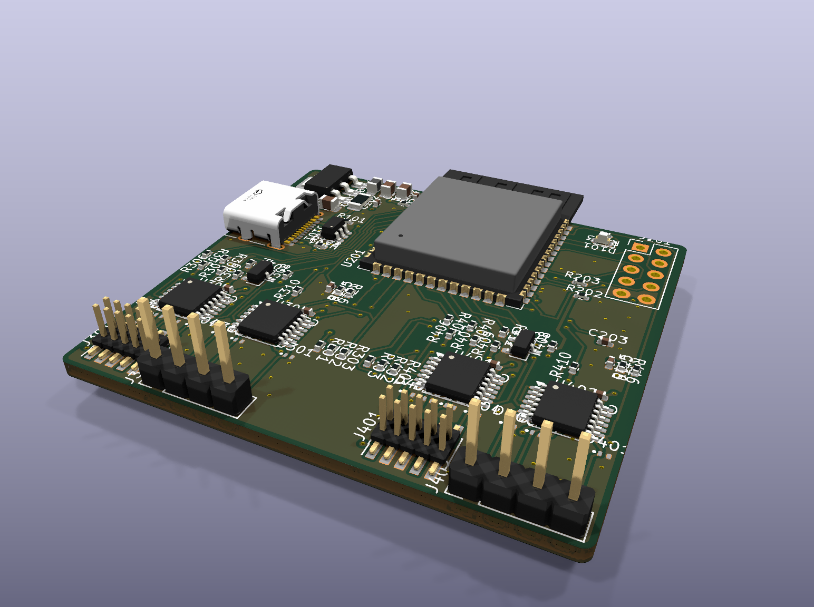

# Hardware reference: board r5 (design revision d)

The firmware's source of truth for the hardware. Extracted 2026-11-06 from the r5 netlist
(`hardware/rev5/kicad`, PCB sha256 `b68c9d79…`, ERC and DRC clean). If this file and `docs/hardware/architecture.md`
disagree, this file wins: architecture.md keeps the history of earlier revisions (translators, VIO regulators, I/O
expander, LEDs, buttons) that are **not** on the board.

## 1. What is on the board
- ESP32-S3-WROOM-1 module (U201). The design calls for N16; **the boards built carry N4 modules** (4 MB quad flash,
  no PSRAM, chip v0.2, 40 MHz crystal). See section 10 for which modules fit.
- USB-C (J101), USB 2.0 full speed only, wired to the ESP32's native USB (GPIO19/20). The board is a sink only: 5.1 kΩ
  on CC1 and CC2. No USB-UART bridge chip is fitted.
- Two identical DUT channels, **A** (STM32 by convention) and **B** (nRF5340). Each channel has:
  - an ARM 10-pin 1.27 mm SWD header (J301/J401) and a 1×4 2.54 mm UART header (J302/J402);
  - two TMUX1511 quad SPST isolation switches (U301/U302, U401/U402);
  - an ESD321 diode on every DUT line;
  - an nRESET open-drain driver (2N7002).
- One white status LED (D101).
- No buttons. No I/O expander. No VIO regulators or level translators: **DUT I/O must be 3.3 V**.
- Power: VBUS → F101 (0 Ω link) → FB101 → +5V → AMS1117-3.3 → +3V3. The DUT is never powered by the tool:
  VTref is a sense input only.
- Board 49 × 45 mm, 2 layers.
  - Top view: USB-C on the left edge, ESP32 at the top centre with its antenna at the top edge, AMS1117 at the top left.
  - Channel A connectors are bottom left, channel B bottom right. The DNP header J201 is at the top right.
  - Test pads are on the bottom side.



## 2. ESP32-S3 pin map
Module pad numbers are in brackets.

| GPIO [pad] | Net | Dir | Hardware around it | Notes |
|---|---|---|---|---|
| 4 [4] | A_SWDIO | I/O | 33 Ω R305 → A_SWDIO_T (100 kΩ pull-up R306) | SWD data A |
| 5 [5] | A_SWCLK | out | 33 Ω R304 → A_SWCLK_T (100 kΩ pull-down R307) | SWD clock A |
| 6 [6] | A_SWO | in | 100 kΩ pull-up R309 | SWO A (UART RX or RMT capture) |
| 7 [7] | A_NRST_DRV | out | gate of Q301, 100 kΩ pull-down R312 | **high = assert DUT reset (low)** |
| 15 [8] | A_NRST_SENSE | in | Q301 drain, 100 kΩ pull-up R308 | reads the reset line |
| 16 [9] | A_UART_TX | out | direct to U302 S2 | UART to DUT A |
| 17 [10] | A_UART_RX | in | 100 kΩ pull-up R310 | UART from DUT A |
| 8 [12] | A_VTREF_ADC | analog | VTref/2 (100 k/100 k R315/R316, 100 nF C316) | ADC1_CH7 |
| 9 [17] | A_EN_SWD | out | 100 kΩ pull-down R301, TP306 | U301 SEL1–4 |
| 46 [16] | A_EN_UART | out | 100 kΩ pull-down R302, TP307 | U302 SEL1+SEL2. Strapping pin, see section 8 |
| 10 [18] | A_EN_VTREF | out | 100 kΩ pull-down R303, TP305 | U302 SEL3 |
| 11 [19] | B_SWDIO | I/O | 33 Ω R405, 100 kΩ pull-up R406 | SWD data B |
| 12 [20] | B_SWCLK | out | 33 Ω R404, 100 kΩ pull-down R407 | SWD clock B |
| 14 [22] | B_SWO | in | 100 kΩ pull-up R409 | SWO B |
| 21 [23] | B_NRST_DRV | out | gate of Q401, 100 kΩ pull-down R412 | **high = assert DUT reset** |
| 47 [24] | B_NRST_SENSE | in | Q401 drain, 100 kΩ pull-up R408 | reads the reset line |
| 48 [25] | B_UART_TX | out | direct to U402 S2 | UART to DUT B |
| 35 [28] | B_UART_RX | in | 100 kΩ pull-up R410 | UART from DUT B (needs a module without octal PSRAM) |
| 1 [39] | B_VTREF_ADC | analog | VTref/2 (R415/R416, C416) | ADC1_CH0 |
| 40 [33] | B_EN_SWD | out | 100 kΩ pull-down R401, TP406 | U401 SEL1–4 |
| 41 [34] | B_EN_UART | out | 100 kΩ pull-down R402, TP407 | U402 SEL1+SEL2 |
| 42 [35] | B_EN_VTREF | out | 100 kΩ pull-down R403, TP405 | U402 SEL3 |
| 2 [38] | LED_STATUS | out | R103 1 kΩ → D101 white LED → GND | active high |
| 19 / 20 [13/14] | USB_D− / USB_D+ | USB | SRV05-4 ESD, USB-C J101 | native USB (Serial/JTAG or OTG) |
| 0 [27] | BOOT_BTN | strap | 10 kΩ pull-up R202 | no button fitted (section 8) |
| 3 [15] | TP_GPIO3 | spare | test pad TP201 (bottom) | strap: JTAG source, ignored unless eFuse set |
| 38 [31] | P2_SPI_MOSI | spare | J201 pin 3 | Phase-2 reserve |
| 37 [30] | P2_SPI_MISO | spare | J201 pin 4 | Phase-2 reserve |
| 39 [32] | P2_SPI_SCK | spare | J201 pin 5 | Phase-2 reserve |
| 43 [37] | P2_W5500_CSn | spare | J201 pin 6 | U0TXD: the ROM boot log appears here |
| 44 [36] | P2_W5500_INTn | spare | J201 pin 7 | U0RXD |
| 45 [26] | P2_W5500_RSTn | strap | J201 pin 8, 10 kΩ pull-down R203 | VDD_SPI strap; must stay low at boot |
| 13, 18, 36 | – | spare | not connected (module pads only) | GPIO18 has a high power-up glitch |
| EN [3] | EN (CHIP_PU) | – | 10 kΩ R201 + 1 µF C203 RC | no reset button |

Not available on the module: GPIO26–32 (flash), GPIO33/34 (not on WROOM-1 pads).

**Dedicated-GPIO bundle:** the brief plans SWD bit-bang through the ESP32-S3 dedicated-GPIO peripheral, with
SWCLK/SWDIO of both channels (GPIO4, 5, 11, 12) in one bundle. Any GPIO can join through the GPIO matrix.
**UART mapping:** the native UART1 and UART2 are the intended DUT UARTs. UART0 (GPIO43/44) is the ROM log port on J201.
Any mapping through the GPIO matrix works.

## 3. Channel signal chain (channel A; channel B is identical with 4xx parts)
```
ESP32 ─ tool side (x_*_T / x_*) ─ TMUX1511 S pin ═switch═ D pin ─ DUT side (x_*_D) ─ ESD321 ─ connector

GPIO4  A_SWDIO  ─ 33R ─ A_SWDIO_T (100k↑, TP304) ─ U301 S2/D2 ─ A_SWDIO_D ─ J301.2
GPIO5  A_SWCLK  ─ 33R ─ A_SWCLK_T (100k↓, TP303) ─ U301 S1/D1 ─ A_SWCLK_D ─ J301.4
GPIO6  A_SWO    (100k↑) ─────────────────────────── U301 S4/D4 ─ A_SWO_D   ─ J301.6
GPIO15 A_NRST_SENSE (100k↑) ── Q301 drain ───────── U301 S3/D3 ─ A_NRST_D  ─ J301.10
GPIO7  A_NRST_DRV (100k↓) ─ Q301 gate (source GND)
GPIO16 A_UART_TX ────────────────────────────────── U302 S2/D2 ─ A_UART_TX_D ─ J302.2
GPIO17 A_UART_RX (100k↑) ────────────────────────── U302 S1/D1 ─ A_UART_RX_D ─ J302.3
GPIO8  A_VTREF_ADC ─ 100k/100k + 100nF ─ A_VTREF_T (TP301) ─ U302 S3/D3 ─ A_VTREF_D ─ J301.1 and J302.4
                                                    U302 S4/D4/SEL4 unused (SEL4 floats, internal pull-down: open)
```
- All pull-ups go to +3V3 and sit on the **tool side** of the switch. With the switch open, the DUT sees no pull,
  only switch and ESD leakage.
- The ESD321 diodes (D301–D307, D401–D407) are on the DUT side, GND referenced.

### Switch groups and enables (active high, 100 kΩ pull-down on each)
| Enable | Ch A GPIO | Ch B GPIO | Closes |
|---|---|---|---|
| x_EN_SWD | 9 | 40 | SWCLK, SWDIO, nRESET, SWO (all four switches of U301/U401) |
| x_EN_UART | 46 | 41 | UART TX and RX (U302/U402 sw1+sw2) |
| x_EN_VTREF | 10 | 42 | VTref sense (U302/U402 sw3) |

TMUX1511, from its datasheet ([tmux1511.pdf](https://www.ti.com/lit/ds/symlink/tmux1511.pdf); links in `datasheets/README.md`):
- RON about 2 Ω, CON about 3.3 pF, IS(OFF) 0.03 nA typical.
- Powered-off protection to 3.6 V: with the tool unpowered, the switches are open.
- SEL has an internal ~6 MΩ pull-down.
- SEL-to-output transition time is 25 ns typical, 55 ns max at 3.3 V. Allow ≥ 1 µs before using a path after
  closing it.

### nRESET
- Driving x_NRST_DRV **high** turns the 2N7002 on and pulls the tool-side reset line low. It reaches the DUT only
  while **x_EN_SWD is closed**.
- The line is never driven high: R308/R408 (100 kΩ) plus the DUT's own pull-up release it.
- x_NRST_SENSE reads the actual line. Use it to check that the DUT came out of reset, or to detect a DUT that holds
  its own reset.
  - With the switch open it reads high (local pull-up) unless Q301/Q401 is on.
- nRESET is the only DUT power or reset control. There is **no DUT power switch** on r5.

### VTref sense
- The ADC sees VTref / 2 (100 kΩ / 100 kΩ, 100 nF), and only while **x_EN_VTREF is closed**. Otherwise R316/R416
  pull the ADC pin to 0 V.
- 3.3 V on the DUT gives about 1.65 V at the pin. Use 11/12 dB attenuation and the calibrated ADC driver.
- Source impedance is 50 kΩ, buffered by 100 nF. τ = 100 kΩ · 100 nF / 2 = 5 ms, so after closing EN_VTREF wait
  **≥ 25 ms** before trusting the reading.
- While closed, the divider **loads the DUT supply with 200 kΩ (about 16.5 µA at 3.3 V)**. Open EN_VTREF before any
  current measurement.

## 4. Connectors
**J301 (A) / J401 (B): ARM Cortex 10-pin, 1.27 mm, SMD male (C3975188)**

| Pin | Signal | Pin | Signal |
|---|---|---|---|
| 1 | VTref (sense input, through the EN_VTREF switch) | 2 | SWDIO |
| 3 | GND | 4 | SWCLK |
| 5 | GND | 6 | SWO |
| 7 | key / NC | 8 | NC |
| 9 | GND (GNDDetect) | 10 | nRESET |

**J302 (A) / J402 (B): UART, 1×4 2.54 mm THT (hand-soldered)**

| Pin | Signal |
|---|---|
| 1 | GND |
| 2 | TX: tool output, goes to the DUT's RX |
| 3 | RX: tool input, comes from the DUT's TX |
| 4 | VTref (same net as J301/J401 pin 1) |

**J201: 2×5 2.54 mm, DNP (Phase-2 reserve; pads are on the board)**

| Pin | Signal | Pin | Signal |
|---|---|---|---|
| 1 | +3V3 | 2 | +5V |
| 3 | GPIO38 | 4 | GPIO37 |
| 5 | GPIO39 | 6 | GPIO43 (U0TXD) |
| 7 | GPIO44 (U0RXD) | 8 | GPIO45 (strap, 10 kΩ pull-down) |
| 9 | GND | 10 | GND |

Soldering a header onto J201 gives the UART0 console (pins 6/7/9) and three free GPIOs (37/38/39).

**J101: USB-C.** Data lines go to GPIO19/20. CC1/CC2 have 5.1 kΩ pull-downs (5 V sink, default USB current).

## 5. Test pads (bottom side, 1 mm round)
| Pad | Net | Pad | Net |
|---|---|---|---|
| TP101 | +5V | TP102 | +3V3 |
| TP103, TP104 | GND | TP201 | GPIO3 |
| TP301 / TP401 | x_VTREF_T (tool side) | TP303 / TP403 | x_SWCLK_T |
| TP304 / TP404 | x_SWDIO_T | TP305 / TP405 | x_EN_VTREF |
| TP306 / TP406 | x_EN_SWD | TP307 / TP407 | x_EN_UART |

## 6. Safe defaults and the firmware interlock
**Power-up state, with no firmware help:**
- Every EN pin resets as an input without an internal pull (GPIO46 gets a weak pull-down).
- The 100 kΩ pull-downs hold every switch **open** through power-up, reset, brown-out, ROM bootloader and download
  mode.
- Firmware must keep this property: drive EN pins only after configuring them as outputs, low first.
- Never enable an internal pull-up on an EN pin.

**Back-powering hazard:**
- With a signal group closed and the DUT unpowered, the tool back-powers the DUT through:
  - the tool-side pull-ups (SWDIO, SWO, nRESET sense, UART RX);
  - the driven lines (SWCLK, SWDIO, UART TX).
- The hardware cannot prevent this. Firmware must.

**Required connect sequence per channel:**
1. Close **EN_VTREF**, wait ≥ 25 ms, read VTref.
2. If VTref ≥ about 2.8 V (ADC pin ≥ about 1.4 V), the DUT is powered.
3. Before closing the switches, put the tool-side lines in a safe state:
   - SWCLK low;
   - SWDIO as an input;
   - UART TX idle high;
   - NRST_DRV low.
4. Close **EN_SWD** and/or **EN_UART**. They are independent of each other ("mixed" mode is allowed).
5. While connected, keep checking VTref. If it drops, open the signal groups at once.

**Disconnect / measurement mode sequence:**
1. End the debug session. On nRF5340: leave debug mode, then pin reset. On STM32: debug bits survive a system reset;
   only a power-on reset clears them.
2. Release nRESET.
3. Open EN_SWD and EN_UART.
4. Open EN_VTREF last.
- Open EN_VTREF too before measuring: its divider draws about 16.5 µA.
- In ISOLATED mode the remaining DUT load is only the leakage of the TMUX1511 switches and ESD321 diodes (≈ 1 nA
  typical for the seven lines).

## 7. Speed limits from the hardware
- SWD: the path is designed for ≤ 10 MHz (33 Ω series resistor, ~3 pF switch, ESD diode about 1 pF). Typical use is
  2–8 MHz. Cable to the DUT ≤ 20 cm.
- UART: ≥ 1 Mbaud through the switch. Measured: 1 Mbaud full duplex with 0 errors, but only with the ESP32-S3 TX at
  its weakest drive strength or with the UART RX glitch filter on (the firmware sets both). At full drive, TX edges
  couple into the tool's own RX over jumper wires: about 7e-4 bytes in error at 460800 baud.
- SWO: GPIO6/14 can be a UART RX (Manchester or NRZ needs firmware decoding) or an RMT input.

## 8. Boot, straps and reflashing
| Strap | Hardware | Effect |
|---|---|---|
| GPIO0 | 10 kΩ pull-up | SPI boot (normal) |
| GPIO46 | 100 kΩ pull-down (A_EN_UART) + internal weak pull-down | any value for SPI boot; must be low for download boot (it is) |
| GPIO45 | 10 kΩ pull-down | VDD_SPI = 3.3 V (correct for 3.3 V flash modules) |
| GPIO3 | test pad only | JTAG source select, only if the eFuse asks for it |

- **No BOOT/RESET buttons.**
  - esptool enters download mode through the USB-Serial-JTAG peripheral (the ROM default; VID:PID 303a:1001).
  - MicroPython or TinyUSB firmware enumerates as a different device (e.g. 303a:4001) and no longer has
    USB-Serial-JTAG.
  - A firmware that owns the USB-OTG peripheral (CDC-NCM) **must provide a "reboot to download mode" command**.
  - On the ESP32-S3, setting `RTC_CNTL_FORCE_DOWNLOAD_BOOT` (`0x6000812C` bit 0) and restarting is only enough while
    USB-Serial-JTAG owns the PHY, as in the current esp-swd test firmware.
  - Under USB-OTG, the PHY mux (`RTC_CNTL_USB_CONF_REG`, `0x60008120`, bits 19/20) is in the RTC domain and survives
    the restart. The ROM then serves a port nobody can reach. One of the following is needed:
    - (a) set the ROM OTG persist flags before the restart (`usb_dc_prepare_persist()` +
      `chip_usb_set_persist_flags(USBDC_PERSIST_ENA)`, as in IDF's `esp_usb_console_before_restart()`). The ROM then
      comes up as OTG CDC `303a:0002`, which esptool supports;
    - (b) detach from the bus (pull-up off), map the PHY back to USB-Serial-JTAG (bits 19/20 = 0), set the flag and
      reset.
  - Without the detach the host keeps the stale device. On 2026-11-06 the board then needed `sudo usbreset` to show
    up as `303a:1001`; the procedure is in `app/README.md`.
  - A replug (power-on reset) clears both registers and boots the app again.
- **Last-resort recovery:** short module pad 27 (GPIO0, castellated edge) to GND while plugging in USB.
- The ROM log appears on U0TXD (GPIO43), which only reaches J201 pin 6 (DNP). Over USB-Serial-JTAG the ROM also logs
  to the host.
- A blank or erased flash prints `invalid header: 0xffffffff` and re-enumerates about every 3 s (TG0WDT reset).
  This is normal.

## 9. Power budget
- AMS1117-3.3 (1 A max, dropout about 1.1 V) runs from USB 5 V. 3.3 V loads: ESP32 module (Wi-Fi TX peaks
  about 355 mA, 802.11b at 20.5 dBm) and four TMUX1511 (µA).
- C104 22 µF + C105 100 nF on the regulator output; C201 10 µF + C202 100 nF at the module.
- +5V is available only on J201 pin 2 and TP101.

## 10. Module compatibility (ESP32-S3-WROOM-1 / -1U)
| Variant | Works? | Why |
|---|---|---|
| N4 (fitted), N8, N16 (designed), H4 | yes | quad flash, no PSRAM |
| N4R2, N8R2, N16R2 | yes | 2 MB **quad** PSRAM sits on the internal flash bus |
| N4R8, N8R8, N16R8 | **no** | octal PSRAM uses GPIO35/36/37: GPIO35 is B_UART_RX |
| N16R16VA | **no** | octal PSRAM, and VDD_SPI 1.8 V also drops GPIO47/48 (B_NRST_SENSE, B_UART_TX) to 1.8 V |

-1U variants (external antenna, U.FL) fit the same footprint.
- Flash size: the fitted N4 modules have 4 MB. Size partitions, OTA slots and stored target images for 4 MB, or plan
  to fit N8/N16 modules.

## 11. Firmware requirements from the brief (summary; full text in `hardware/design-brief.md`)
- Host link: USB 2.0 FS on USB-C, enumerating as **CDC-NCM** (USB network adapter). Each UART, each SWD channel and the
  control interface is a **TCP port**.
- Per-channel states: **ISOLATED** (default: all switches open), **CONNECTED** (VTref detected, groups closed),
  **mixed** (UART and SWD groups switched independently).
- Production sequence: detect VTref → close switches → program the STM32 (channel A) and nRF5340 app + net core
  (channel B) → end the debug session → pin reset → open switches → external power measurement.
- SWD by bit-bang through dedicated GPIO, up to 10 MHz. UART ≥ 1 Mbaud.
- UI: one status LED (GPIO2). The brief's per-channel LEDs and button were dropped in revision (d).
- Phase 2 (not on r5): W5500 Ethernet over SPI (J201 pins reserved), BLE gateway.

## 12. Bring-up status (2026-11-06, updated 2026-11-10)
| Board MAC | Module | State |
|---|---|---|
| f0:f5:bd:57:ef:48 | N4, chip v0.2 | USB OK after re-soldering module pad 13 (D−); flash still blank |
| f0:f5:bd:57:ef:34 | N4, chip v0.2 | MicroPython v1.29.0 + blink on GPIO2 (`firmware/bringup/`) |

Both boards verified:
- USB enumeration;
- 3.3 V rail;
- straps (boot:0x8 SPI boot, flash at 3.3 V);
- flash read/write.

Not yet exercised: isolation switches, SWD, UART, VTref ADC.

### SWD board test, 2026-11-06
Run with `firmware/poc_swd`, `./run.sh diag A`, on board 2 channel A, against an nRF52840 DK:
- DK connector: P18 Debug in;
- DK switches: SW6 nRF ONLY, SW9 VDD;
- log: `firmware/poc_swd/logs/diag_A_20261106_193131.log`.

| Item | Result |
|---|---|
| Netlist check of U301/U302/U401/U402 against the TMUX1511 TSSOP-14 pinout (all 56 pins), SEL polarity, EN nets to GPIO and test pads | all correct |
| Tool-side pulls R306/R307/R308/R309/R310, Q301 nRESET driver, VTref ADC at 0 V with the switch open | pass |
| U302 sw3 (VTref) | open: 0.000 V; closed: 2.98 V (DK VDD), noise ±1 mV |
| U301 (SWD group) | DUT pulls on SWCLK, SWDIO and nRESET visible through the closed switch; nRESET pulse resets the DK, rise 71 µs |
| SWD | DPIDR 0x2BA01477, 50/50 clean re-reads at ~24 kHz bit-bang; debug power-up OK; CTRL-AP IDR 0x02880000 |
| APPROTECT | the DK came locked: AP0 IDR read 0x23000000 |
| Unlock (`diag.recover`, log `recover_A_20261106_194747.log`) | ERASEALL 220 ms → AP0 IDR 0x24770011, CPUID 0x410FC241, FICR PART 0x52840 VARIANT "AAF0" (build code F: hardware APPROTECT at every reset), 256 KB RAM / 1 MB flash; UICR.APPROTECT ← HwDisabled written via NVMC and read back |
| Flash (`diag.flash_blinky`, log `flash_A_20261106_195211.log`) | 64-byte hand-assembled image (unlock + LED1–4 chase) programmed through NVMC in 191 ms, verified; UICR.PSELRESET = P0.18; after a CTRL-AP reset APPROTECT stays open and P0.OUT shows the chase; halt PC 0x1E inside the image |
| Full test after flashing (log `diag_A_20261106_195222.log`) | **22 pass, 1 warn (DUT VDD 2.98 V), 0 fail**: every stage including AHB-AP memory reads and halt/resume |
| C firmware (`app/`, ESP-IDF v6.0.3), Python example `host/python/examples/nrf52_blinky.py` | interlock (VTref 2978 mV, then SWD closes), attach 2 ms, RAM 16 KB round trip OK at 95 KB/s end to end (128 KB/s on the device, about 1.5 MHz effective SWD), page erase 85 ms, program and verify OK, CTRL-AP reset, LED chase seen in P0.OUT; 8,922 transfers with 0 WAIT/FAULT/no-ACK/parity errors |
| Robustness (`host/python/examples/robustness_check.py`, 10/10) | reset-halt works on build code F with UICR HwDisabled (and the chip stays open after reset-halt or normal reset with valid, blank or random flash; a random 256 KB image did lock it while running, recovered by mass erase); a deliberate panic with SWD closed leaves the board back in 348 ms (reset reason 4), isolated and on USB; host vanishing mid-session ends the session (debug off, pin reset) and isolates the channel; REBOOT rejects unknown modes and a normal REBOOT with SWD held comes back isolated |
| Update path | `idf.py flash` over USB-Serial-JTAG while the esp-swd firmware runs: no button, no replug |
| Full-flash speed (`host/python/examples/flash_speed.py --size 1M --window 3`) | 1 MB random data: erase 0.18 s (NVMC ERASEALL, UICR saved and restored), program 8.71 s (117.6 KB/s), verify by read-back 8.97 s (114.1 KB/s), **total 17.9 s**; 543,790 SWD packets, 589 WAIT, 0 FAULT/no-ACK/parity. Baseline before the bulk path: about 110 s. Programming is now limited by the bit-banged SWD (about 1.5 MHz), not the flash: about 33.6 µs per word measured against tWRITE 41 µs in the spec |
| Dedicated-GPIO SWD engine (`ports/esp32s3/esw_dgpio.c`, `swd_bench.py --phy 1`) | Device-side: 7.37 µs per packet at 8 MHz (bit-bang 31.3 µs), DPIDR 135 k/s, RAM block write 525 KB/s, read 524 KB/s. Soak: about 3.0 M packets each at 8 MHz and 10 MHz with 0 data, parity, no-ACK or FAULT errors (10 MHz is above the nRF52840's 8 MHz spec: margin only). The actual clock matches the request. After the third review (stall re-base, bounded OE fence): 150 kHz and 300 kHz, where interrupts stay enabled during packets, ran with 0 errors; 8 MHz costs 7.5 µs per packet |
| Full flash, dgpio at 8 MHz | 1 MB random data: erase 0.17 s, program 3.08 s (333 KB/s, about 11.7 µs per word including WAITs, so the real nRF52840 tWRITE is far below the 41 µs worst case), verify by read-back 2.72 s, **or verify by on-target CRC 0.17 s: total 3.42 s** (about 110 s before the bulk path, 17.9 s with bit-bang). A CRC mismatch on one corrupted word was detected |
| APPROTECT across resets (UICR HwDisabled) | Stays open after reset-halt and after a normal reset with valid, blank (erased page 0) or random flash, as long as the debug session stays connected through the reset. A random 256 KB image locked the chip while it ran; a mass erase (`--allow-erase`) recovered it |
| UART, channel A (2026-11-09, `host/python/examples/uart_test.py`, 22/22) | J302 GND/TX/RX to DK GND/P1.01/P1.02, test firmware `testfw/nrf52840_uart`. Interlock closes U302 sw1/sw2 only with VTref valid; boot banner caught from the first byte after an SWD reset and after an nRESET pin reset; echo byte-exact at 115200, 460800 (nRF actual 457143, −0.8 %) and 1 Mbaud; full duplex 195 KB each way at 1 Mbaud with 0 errors; 1 MB DK → tool byte-exact at 1 Mbaud (DK-limited 93 KB/s) with 2,600 SWD reads in parallel and a 250 ms host stall; 256 KB tool → DK at 97 KB/s, CRC verified on the DK; released group: 0 bytes in, writes refused; held again: ticks resume and TX works (pads re-routed). Counters: 0 FIFO overflow, 0 buffer full, 0 USB drop, 0 framing/parity/break on both ends |
| UART back-ends (2026-11-09) | `uart_test.py` 22/22 on the DMA back-end (UHCI + GDMA circular chain) and 21/21 on the hardened IRQ back-end; `uart_stress.py` on channel A, 30 s each: 1 Mbaud full duplex 2.5 MB each way + 4,000 SWD reads + a flash sector erase every 250 ms (cache off about 40 ms each): 0 errors, 0 FIFO overflow, 0 buffer full on both back-ends |
| UART findings | (1) TX edges at full drive corrupted the tool's RX (DK → tool only): fixed by weak drive + RX glitch filter (defaults). (2) `usb_serial_jtag_is_connected()` reports brief false disconnects under load: not used to drop data any more. (3) An nRESET pin reset of the DK shows up as one 0x00 byte on the tool's RX before the banner (not seen with an SWD reset) |
| Channel B, first powered target (2026-11-10) | VTref 3.27 V, SWD at 8 MHz with 0 errors over 1.06 M transfers. With the 10-pin cable rotated 180° VTref read **2.70 V**: pin 1 then sits on the DUT's nRESET, whose pull-up (STM32: about 40 kΩ) against the 200 kΩ divider gives about 2.75 V, just under the 2.8 V threshold, so the interlock stayed open (correct). An earlier 1.72 V was another wrong connection |
| STM32U585 (channel B, 2026-11-10) | DPIDR 0x0BE12477, TARGETID 0x24820041, DBGMCU_IDCODE 0x30016482, OPTR 0x1FEFF8AA (RDP 0, TZEN 0, dual bank). Bank erase 0.33 s; 2 MB random burst-programmed in 13.3 s (154 KB/s), on-target CRC 3.9 s (core at 4 MHz after reset); RDP 0 → 1 → unlock (regression, mass erase, option reload, reconnect) in 0.43 s; its firmware written back afterwards, boots |
| nRF5340 (channel A, 2026-11-10) | DPIDR 0x6BA02477, TARGETID 0x50070289, AP0/AP1 AHB-APs, AP2/AP3 CTRL-APs; app and network cores attach at 8 MHz. 1 MB app image: fast whole-flash erase (KMU slots proven empty, NVMC ERASEALL, UICR restored) + program 333 KB/s + CRC = 3.5 s. A random test image shut the debug port after the pin reset (firmware APPROTECT branch); recovered by CTRL-AP ERASEALL, then its firmware written back |
| STM32U585 streaming loader (2026-11-10) | 2 MB random: erase 0.35 s, program 6.37 s (322 KB/s, probe-driven bursts were 154 KB/s), CRC 0.29 s at MSIS 48 MHz (3.9 s at the 4 MHz reset clock); real 1.2 MB image 4.2 s; 94 WAITs per 2 MB instead of 2.6 M |
| nRF5340 network core (2026-11-10) | 256 KB image written through the fast whole-flash erase in 0.71 s (page by page: 12 s); UICR identical afterwards |
| Parallel channels (2026-11-10) | nRF5340 + STM32U585 at once from two host threads: 10.8 s wall against 14.6 s sequential (STM32 probe-driven, on core 1); with the STM32 loader 5.5 s against 7.5 s. USB-Serial-JTAG carries at most about 485 KB/s toward the board; the two channels together reach about 390 KB/s. Both sessions end cleanly on host loss and on REBOOT |
| Both UARTs at once (2026-11-11, firmware 0.5.0) | Internal loopback (`ESW_UART_LOOPBACK`, no pads), full duplex on A (DMA) and B (IRQ) at once through USB: 1 Mbaud 97.6 KB/s each way per channel, 2 Mbaud 195 KB/s (about 780 KB/s over USB-Serial-JTAG in total), 0 lost, 0 FIFO overflow. Through the host daemon's PTYs with pyserial: 1 Mbaud on both, byte-exact, also during an STM32 flash and an nRF5340 read-back |
| Switch modes (2026-11-11) | Channel B: mode `on` closes the UART group at VTref 3.27 V with nothing open; `off` opens it and VTref sensing too, also with a TTY open (writes dropped); `auto` closes it while the TTY is open and opens it when the TTY closes |
| USB across a software restart | USB-Serial-JTAG stays enumerated through `esp_restart()` (REBOOT, panic): the host keeps the same `/dev/ttyACM0` and sees no disconnect. The daemon detects a restart by the board's uptime |
| UART pads, A ↔ B (2026-11-11) | Cables J302.2 → J402.3 and J402.2 → J302.3 (common GND on the board). Both directions at once through U302/U402, via the daemon's TTYs: byte-exact at 115200, 460800, 1 M and 2 Mbaud; 8E1 at 1 Mbaud; 20 s at 1 Mbaud (2 MB each way) during a dual-DUT flash: 0 framing, parity, FIFO-overflow or buffer-full errors. Default drive (weakest) and RX glitch filter |
| DUT consoles (2026-11-12) | J302/J402 wired to the nRF5340's and the STM32 board's Zephyr consoles (115200 8N1), read through the daemon's TTYs: after a pin reset 12.4 KB (nRF5340) and 9.7 KB (STM32) of boot log, 0 framing errors. Channel A first showed 0 bytes and 0 framing errors: TX and RX were swapped in the cable |
| Not tested | SWO |

- Note: the DK runs at 2.98 V, so the tool's 3.3 V highs are 0.32 V above DUT VDD. That is at the nRF52840's
  absolute-maximum limit (VDD + 0.3 V).

